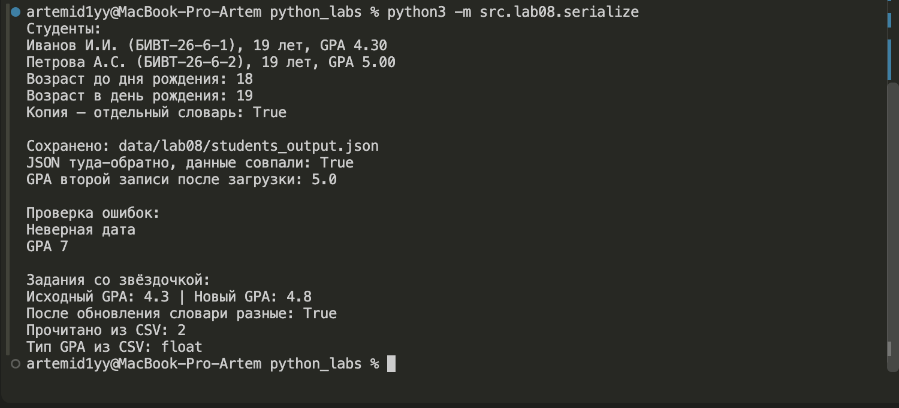

# Лабораторная работа № 8

`src/lab08/models.py` — запись студента как словарь с полями `fio`, `birthdate`, `group`, `gpa`

`src/lab08/serialize.py` — сохранение и загрузка студентов в JSON, чтение CSV

## Модель студента

>- `validate_student` проверяет набор ключей, непустые ФИО и группу, существующую дату не из будущего и GPA от 0 до 5
>- `make_student` создаёт запись, убирает пробелы по краям строк и приводит GPA к float
>- `student_age` учитывает, наступил ли день рождения в этом году
>- `format_student` выводит фамилию с инициалами, группу, возраст и GPA с двумя знаками после точки
>- `student_to_dict` возвращает копию, `student_from_dict` преобразует внешний словарь и проверяет данные
>- булевый GPA, лишние и пропущенные поля вызывают `ValueError`

## JSON и ошибки

>- `students_to_json` сохраняет список с `ensure_ascii=False` и `indent=2`
>- `students_from_json` проверяет каждую запись через `student_from_dict`
>- выбрал политику strict — первая неверная запись останавливает загрузку с номером и причиной ошибки

[Входной JSON](../../data/lab08/students_input.json) → [полученный JSON](../../data/lab08/students_output.json)

Фрагмент второй записи до и после преобразования

```text
До:    "gpa": 5
После: "gpa": 5.0
```

## Задания со звёздочкой

>- `update_student` создаёт новую запись с изменениями, исходная не меняется
>- неизвестное поле при обновлении вызывает `KeyError`, неверное значение — `ValueError`
>- `students_from_csv` читает `data/lab08/students.csv` через DictReader
>- GPA приходит из CSV строкой и преобразуется в float внутри `student_from_dict`
>- заголовок CSV проверяется в порядке `fio,birthdate,group,gpa`

## Запуск

Из корня проекта одной командой показываются студенты, возраст, копирование, JSON туда-обратно, ошибки и задания со звёздочкой

```bash
python3 -m src.lab08.serialize
```

Результат сохраняется в `data/lab08/students_output.json`


