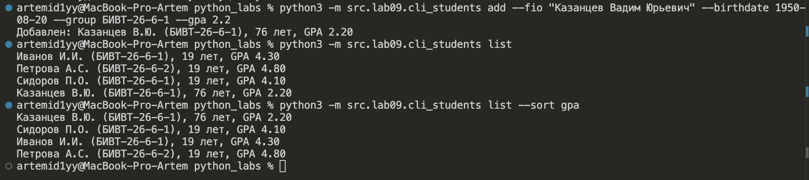
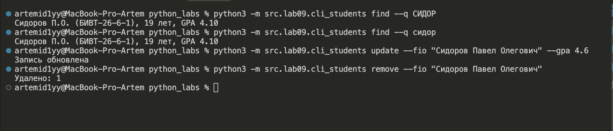
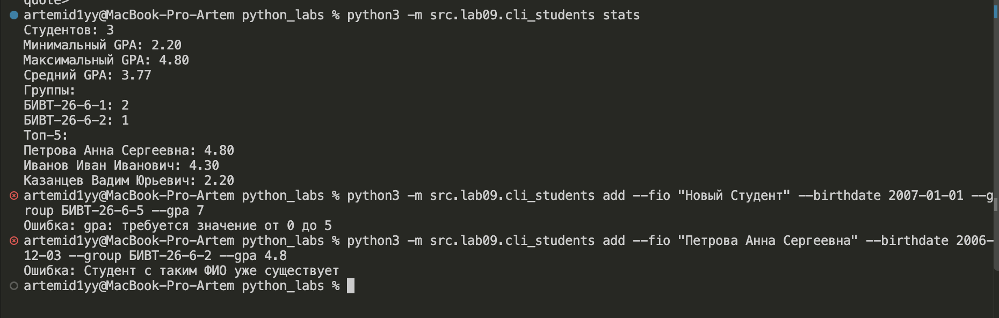

# Лабораторная работа № 9

`group.py` — хранилище студентов в CSV: добавление, список, поиск, обновление и удаление

`cli_students.py` — запуск операций через подкоманды argparse

## Хранилище и проверки

> - файл создаётся с заголовком `fio,birthdate,group,gpa`, если его ещё нет
> - изменения выполняются по схеме «загрузить → изменить → сохранить»
> - записи проверяются функциями ЛР8, строковый GPA из CSV приводится к `float`
> - поиск подстроки не учитывает регистр, обновляется первая запись по ФИО, удаляются все совпадения
> - ошибки данных выводятся в stderr с кодом завершения 1

## Сценарий запуска

Из корня `python_labs`, команды выполняются по порядку
Возраст в выводе зависит от даты запуска

```console
$ python3 -m src.lab09.cli_students add --fio "Сидоров Павел Олегович" --birthdate 2007-08-20 --group БИВТ-26-6-1 --gpa 4.1
Добавлен: Сидоров П.О. (БИВТ-26-6-1), 19 лет, GPA 4.10

$ python3 -m src.lab09.cli_students list
Иванов И.И. (БИВТ-26-6-1), 19 лет, GPA 4.30
Петрова А.С. (БИВТ-26-6-2), 19 лет, GPA 4.80
Сидоров П.О. (БИВТ-26-6-1), 19 лет, GPA 4.10

$ python3 -m src.lab09.cli_students list --sort gpa
Сидоров П.О. (БИВТ-26-6-1), 19 лет, GPA 4.10
Иванов И.И. (БИВТ-26-6-1), 19 лет, GPA 4.30
Петрова А.С. (БИВТ-26-6-2), 19 лет, GPA 4.80
```



```console
$ python3 -m src.lab09.cli_students find --q СИДОР
Сидоров П.О. (БИВТ-26-6-1), 19 лет, GPA 4.10

$ python3 -m src.lab09.cli_students update --fio "Сидоров Павел Олегович" --gpa 4.6
Запись обновлена

$ python3 -m src.lab09.cli_students remove --fio "Сидоров Павел Олегович"
Удалено: 1
```



Для другого файла общий параметр `--db путь` указывается перед подкомандой


## Задания со звёздочкой и ошибки

> - добавление студента с уже существующим ФИО вызывает `ValueError`
> - `stats` выводит количество студентов, минимум, максимум и средний GPA, состав групп и топ-5
> - у пустого хранилища показатели GPA равны `None`, группы и топ пустые

```bash
python3 -m src.lab09.cli_students stats
python3 -m src.lab09.cli_students add --fio "Новый Студент" --birthdate 2007-01-01 --group БИВТ-26-6-1 --gpa 7
python3 -m src.lab09.cli_students add --fio "Петрова Анна Сергеевна" --birthdate 2006-12-03 --group БИВТ-26-6-2 --gpa 4.8
```

После сценария: 2 студента, средний GPA 4.55
Неверный GPA и повторное ФИО отклоняются без изменения файла


