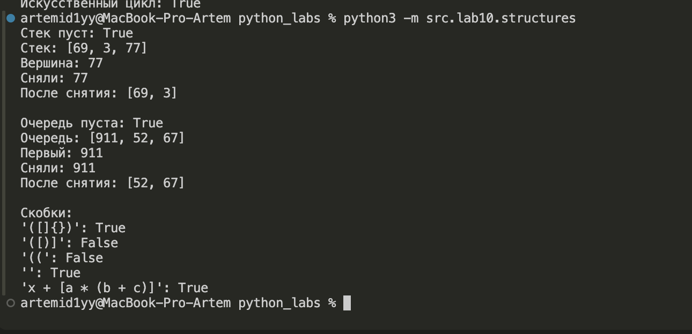
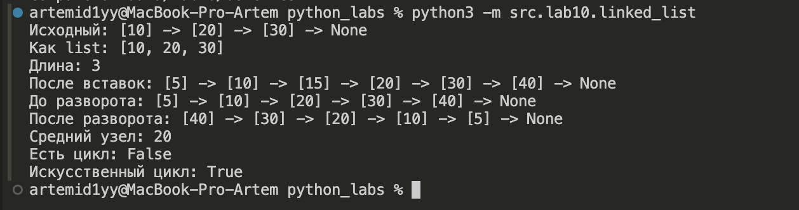
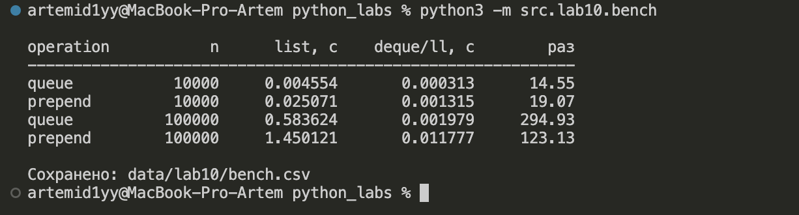

# Лабораторная работа № 10

Реализованы стек на `list`, очередь на `deque` и односвязный список

## Стек и очередь

| Структура | Порядок | Операции | Время |
|---|---|---|---|
| Стек | LIFO, последний добавленный выходит первым | `stack_push`, `stack_pop`, `stack_peek`, `stack_is_empty` | O(1), добавление амортизированно |
| Очередь | FIFO, первый добавленный выходит первым | `queue_enqueue`, `queue_dequeue`, `queue_peek`, `queue_is_empty` | O(1) |

Для пустого контейнера `peek` возвращает `None`, снятие элемента вызывает `IndexError`
`is_balanced` проверяет три вида скобок за O(n) и пропускает остальные символы

```python
from collections import deque
from src.lab10.structures import (
    is_balanced, queue_dequeue, queue_enqueue, stack_pop, stack_push,
)

st = [10]
stack_push(st, 20)
stack_pop(st)                   # 20

q = deque([10])
queue_enqueue(q, 20)
queue_dequeue(q)                # 10

is_balanced('([]{})')           # True
```

```bash
python3 -m src.lab10.structures
```



## Односвязный список

У `Node` есть значение и ссылка на следующий узел

| Функции | Что делают | Время |
|---|---|---|
| `ll_prepend` | Добавляет узел перед головой | O(1) |
| `ll_append`, `ll_insert`, `ll_remove` | Добавляют в конец, вставляют по индексу и удаляют первое совпадение | O(n) в худшем случае |
| `ll_from_list`, `ll_to_list`, `ll_length`, `ll_repr` | Собирают цепочку, выгружают значения, считают узлы и показывают цепочку | O(n) для коротких значений |
| `ll_reverse` | Меняет направления ссылок на месте | O(n) |
| ★ `ll_middle`, `ll_has_cycle` | Ищут средний узел и проверяют цикл алгоритмом Флойда | O(n) |

`ll_reverse`, `ll_middle` и `ll_has_cycle` используют O(1) дополнительной памяти. Для чётного числа узлов `ll_middle` возвращает второй из двух средних

```python
from src.lab10.linked_list import ll_from_list, ll_insert, ll_remove, ll_repr, ll_reverse

head = ll_from_list([10, 30])
head = ll_insert(head, 1, 20)
print(ll_repr(head))  # [10] -> [20] -> [30] -> None
head = ll_remove(head, 20)
head = ll_reverse(head)
print(ll_repr(head))  # [30] -> [10] -> None
```

```bash
python3 -m src.lab10.linked_list
```



## Бенчмарк

Время указано в секундах за `n` операций. Ускорение — отношение времени `list` ко времени второй структуры

| Операция | n | list, с | deque / связный список, с | Ускорение |
|---|---:|---:|---:|---:|
| Удаление с начала | 10 000 | 0.004418 | 0.000238 | 18.58× |
| Вставка в начало | 10 000 | 0.014707 | 0.001010 | 14.57× |
| Удаление с начала | 100 000 | 0.589879 | 0.002090 | 282.20× |
| Вставка в начало | 100 000 | 1.352950 | 0.005847 | 231.41× |

`list.pop(0)` сдвигает ссылки на все оставшиеся элементы, поэтому `n` удалений занимают O(n²). `deque.popleft()` снимает один элемент с края за O(1), и весь замер занимает O(n). На 100 000 удалений `deque` быстрее примерно в 282 раза

`list.insert(0, x)` сдвигает ссылки вправо. `ll_prepend` создаёт один узел и связывает его с прежней головой, поэтому отдельная вставка стоит O(1) независимо от длины. Для `n` вставок получаем O(n²) у `list` и O(n) у связного списка. На 100 000 вставок связный список быстрее примерно в 231 раз

```bash
python3 -m src.lab10.bench
```

[Таблица замеров CSV](../../data/lab10/bench.csv)


